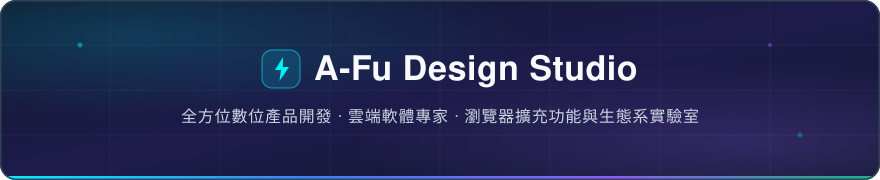

  

    

  

    &nbsp;
    &nbsp;
    &nbsp;
    
  

---

## 📖 關於 A-Fu Design

**A-Fu Design Studio** 致力於將創新構想打磨為極致流暢的數位產品。我們專注於 **高效能網頁設計**、**iOS / Android 跨平台行動應用開發**、**企業級客製化軟體系統**、**純前端隱私優先線上工具**，以及基於 **Manifest V3** 架構的 **Chrome 瀏覽器擴充功能**。

本 GitHub 組織（`fufuk-com`）與儲存庫匯集了 A-Fu Design 的品牌核心主站、數位產品生態系，以及旗艦瀏覽器外掛與實驗性 Web 專案。

---

## 🌟 數位生態系矩陣 (Digital Ecosystem)

A-Fu Design 自主研發並持續維運的多個旗艦平台與互動應用子站：

| 平台名稱 | 官方網址 | 功能與簡介 |
| :--- | :--- | :--- |
| **🏠 品牌官網主站** | [fufuk.com](https://fufuk.com/) | A-Fu Design Studio 官方主站，整合核心軟體開發服務、互動式專案預算估價器、多國語系切換與生態系導覽。 |
| **⚡ 極簡工具箱** | [tool.fufuk.com](https://tool.fufuk.com/) | 面向工程師與日常使用的無廣告線上工具箱，涵蓋格式轉換、編解碼、文字與圖片處理，採純前端運算保護隱私。 |
| **🧩 Chrome 擴充功能中心** | [extension.fufuk.com](https://extension.fufuk.com/) | 旗下 Floor Up Team 打造的 Manifest V3 瀏覽器擴充功能產品展示、使用說明與隱私權政策入口。 |
| **🌍 GeoLab 寰宇探秘** | [geolab.fufuk.com](https://geolab.fufuk.com/) | 互動式 3D 地球儀與全球地理情報平台，提供國家數據檢索、跨國經貿比對與視覺化地理探索體驗。 |
| **🔭 CosmoLens 穹宇之鏡** | [cosmo.fufuk.com](https://cosmo.fufuk.com/) | 天文與太空探索互動平台，結合宇宙影像與沉浸式科學探索體驗。 |
| **🕰️ 歷史上的今天** | [today.fufuk.com](https://today.fufuk.com/) | 時光漫遊網與每日歷史事件檔案館，快速探索不同年代的關鍵時刻。 |
| **🍳 享食靈感 Foodie Lab** | [eat.fufuk.com](https://eat.fufuk.com/) | 冰箱剩菜救星與日常飲食靈感工具，快速發掘料理與飲品搭配方案。 |
| **🎲 擺脫無聊生成器** | [bored.fufuk.com](https://bored.fufuk.com/) | 輕量級趣味點子與迷因梗圖產生器，提供即時的互動娛樂與靈感舒壓。 |

---

## 🧩 Chrome 擴充功能旗艦專案 (Chrome Extensions)

所有擴充功能皆採用 **Chrome Extension Manifest V3** 與 **Local-First 隱私優先架構** 打造，詳情與最新發佈請造訪 [extension.fufuk.com](https://extension.fufuk.com/)：

| 擴充功能 | 定位 | 核心特色 |
| :--- | :--- | :--- |
| **🌌 [Aether Tab](https://extension.fufuk.com/)** | 極簡新分頁與工作區 | 結合即時動態時鐘、自訂質感桌布與分頁工作區管理，協助整理與休眠閒置分頁以節省記憶體。 |
| **✍️ [MarkSense](https://extension.fufuk.com/)** | 智慧書籤搜尋與管理 | 支援正則表達式（Regex）即時檢索、資料夾樹狀檢視、重複書籤掃描與 Chrome 原生側邊欄整合。 |
| **🎨 [Design Token Extractor](https://extension.fufuk.com/)** | 設計系統擷取工具 | 透過 Chrome Side Panel 快速解析網頁色彩、字體與間距等 Design Tokens，無縫銜接 Figma Tokens Studio 工作流。 |
| **🛑 [Scroll Stopper](https://extension.fufuk.com/)** | 反無意識滑動專注工具 | 針對 YouTube Shorts、Instagram Reels、TikTok 與 X 提供滑動配額限制與正念呼吸提醒，守護數位專注力。 |
| **🎮 [TacticalSide](https://extension.fufuk.com/)** | 整合式遊戲戰術側邊欄 | 提供實況與遊戲情境感測 HUD、對戰資料速查與 Steam 價格追蹤等即時輔助工具。 |
| **⚡ [PokeCounter](https://extension.fufuk.com/)** | 屬性計算機與多語圖鑑 | 整合 PokéAPI 的多語系寶可夢圖鑑與屬性相剋計算機，支援太晶化模擬與弱點矩陣分析。 |

---

## 🛠️ 核心技術棧與架構 (Tech Stack & Architecture)

- **前端視覺與體驗 (Frontend & UI/UX)**
  - HTML5、Vanilla CSS（Glassmorphic Design + Animated Mesh Gradient）
  - ES6+ JavaScript、原生 i18n 多國語系引擎
  - Responsive Web Design (RWD)、PWA、Single Page Application (SPA)
- **瀏覽器擴充功能工程 (Browser Extensions)**
  - Chrome Extension Manifest V3、Side Panel API、Service Worker 背景排程
  - 純本地儲存（`chrome.storage.local`）與零追蹤隱私優先架構
- **雲端與 Serverless 基礎架構 (Cloud & Serverless)**
  - Cloudflare Pages 與 Cloudflare Workers 全球邊緣網路
  - AWS、GCP、Azure 雲端部署與 RESTful / GraphQL API 設計
- **企業級系統與資料庫整合 (Enterprise Systems)**
  - Ragic 企業雲端資料庫整合（ERP / CRM / 客製化自動化工作流）

---

## 📬 聯絡與專案諮詢 (Contact & Collaboration)

有品牌官網建置、客製化軟體開發、企業數位轉型或技術合作需求？歡迎與我們聯繫：

- 🌐 **官方網站**：[fufuk.com](https://fufuk.com/)
- 💡 **專案預算試算**：[fufuk.com/#calculator](https://fufuk.com/#calculator)
- ✉️ **線上諮詢表單**：[fufuk.com/#contact](https://fufuk.com/#contact)

---

  © 2026 A-Fu Design Studio (fufuk.com). All rights reserved.

